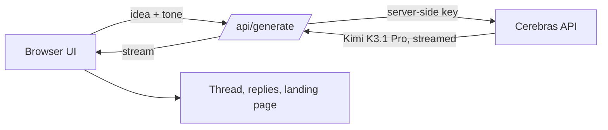

# Strike

**One idea in. A full launch kit out, before you look away.**

X thread · 10 reply hooks · a ready landing page, all streamed from **Kimi K3.1 Pro on Cerebras**.

`#KimiOnCerebras`

---

## What it does

Type what you are launching. Strike writes three things in one streamed response:

| Output | What you get |
| --- | --- |
| **X thread** | Six short posts, numbered and ready to paste |
| **Reply hooks** | Ten one-line hooks in different tones |
| **Landing page** | A self-contained HTML page with live preview, copy and download |

A live timer and tokens-per-second counter run while it generates, and a **DONE** badge with the final time lands on each result.

## How it works

The API key lives in a Vercel environment variable, so it never reaches the browser.

## Run it

**Demo mode** works offline: open `index.html`. Speed in demo mode is simulated and labeled as such.

**Live mode, locally:** open `index.html`, choose *Live*, and paste your Cerebras key. It stays in the tab and is never stored.

## Deploy on Vercel

1. Push this repo to GitHub and import it in Vercel.
2. Add the environment variable `CEREBRAS_API_KEY`.
3. Optional: `CEREBRAS_MODEL` (default `moonshotai-kimi-k3.1-pro-trial`).
   Also optional: `CEREBRAS_REASONING` (`low`, `high`, `max`; default `low`), `CEREBRAS_FALLBACK_MODEL` (default `gpt-oss-120b`), `KIMI_MAX_WAIT_MS` (default 20000).
   If Kimi has not started within the wait, visitors get a labeled fallback run. Tick "Kimi only" to wait for Kimi instead.
4. Deploy, switch to *Live*, and leave the key field empty.

## Features

- Streaming output with live seconds and tokens-per-second
- Tone picker: Confident, Friendly, Playful, Professional
- Recent kits, reloadable in one tap
- Landing page copy and download
- Full-screen ending card for demo videos
- Light and dark themes, reduced-motion friendly

## Security

- No keys in the repo (`.env` is git-ignored)
- Server function accepts one short idea per request and caps output length
- Generated pages render in a sandboxed iframe

## Hackathon

Built for the **Kimi K3.1 Pro × Cerebras × OpenClaw Hackathon**.

- Demo video: _add X post link_
- Live site: _add Vercel link_

## Stack

Plain HTML, CSS and JavaScript · one Vercel serverless function · Cerebras Inference API
